<!-- _class: cover -->

  
  

  <h1>VEILLE TECHNOLOGIQUE</h1>
  
RAG – Retrieval-Augmented Generation

  
This work was created by Badreddine Hammam

  
Formateur: Fouad SERRAG

---

# What is RAG?

RAG lets AI search your documents before it answers. It uses useful facts from them to make a better answer.

---

# Why do we need RAG?

AI alone may not know private company facts. RAG checks the company files first.

---

# How does RAG work?

- **Documents:** Give the system your files.
- **Retrieval:** Find useful parts in those files.
- **Augmentation:** Add the useful parts to the question.
- **Generation:** AI writes an answer using those parts.

---

# Real example: Education

A student asks, “How do I make a PHP variable?” The answer is in a course PDF.

---

# Real example: Companies

A customer asks for a product price. RAG checks the company price list.

---

# Real example: Customer support

A customer asks about returning a product. RAG checks the return rules.

---

# Important RAG technologies

- **Retriever:** Finds useful text.
- **Embeddings:** Turn text into number patterns that help compare meaning.
- **Vector database:** Stores those patterns and helps find similar text.
- **LLM:** The AI that writes the answer.

---

# Two limits to remember

- **Wrong information:** Bad search results can lead to a wrong answer.
- **Complexity:** Several parts must work together.

---

# How to build a simple RAG system

Collect course files, split them into small pieces, make number patterns, store them, then connect search to AI.

---

# Conclusion

RAG allows AI to search external documents before generating an answer.

